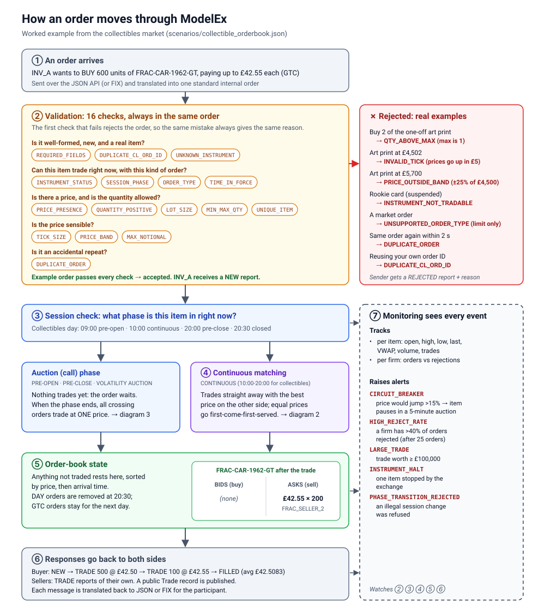
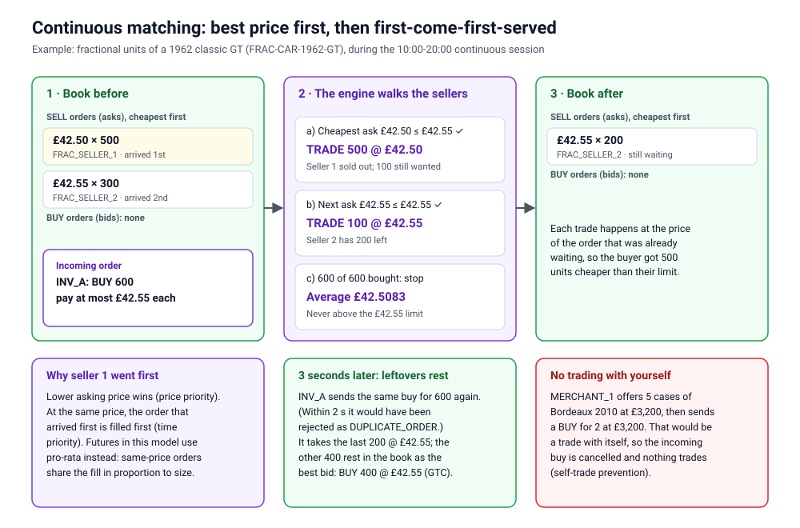
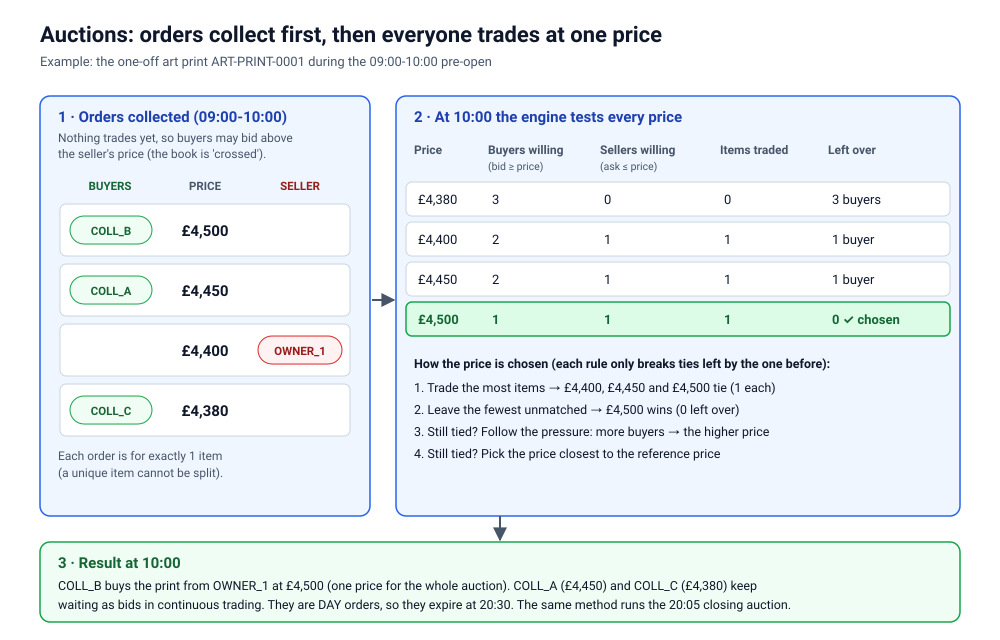
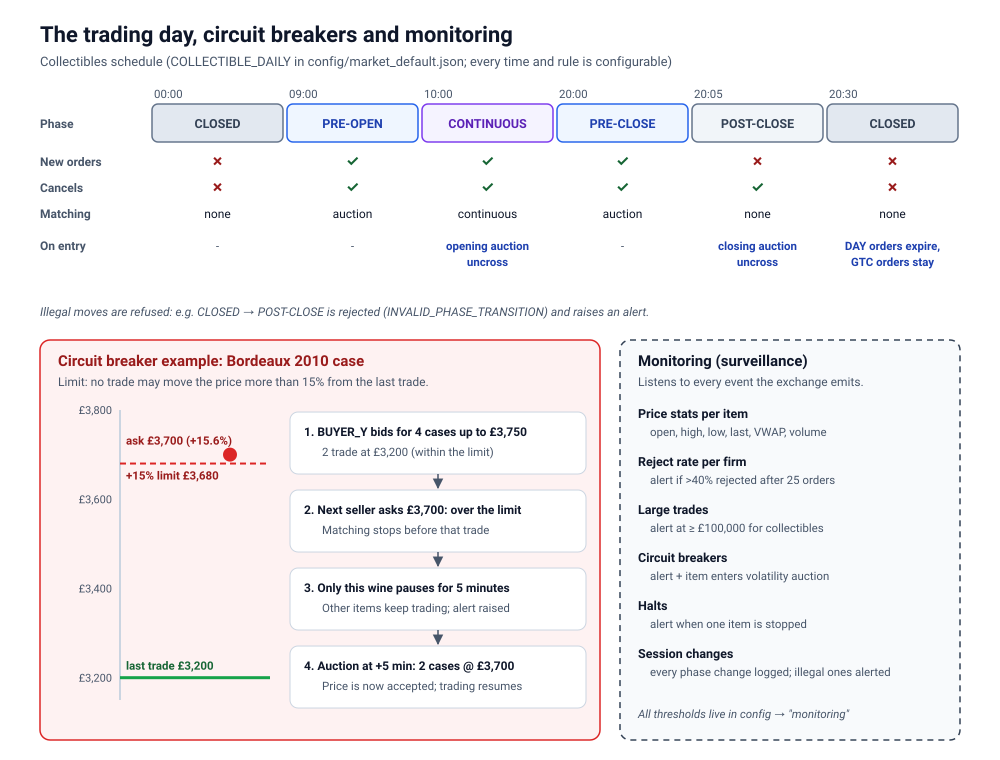

# ModelEx: an open model exchange for model-based testing

## Why this project exists

ModelEx is an **open-source, automated, model-based exchange** that testing, training and executive teams can run inside their own organisations. It can be customised for any market: crypto, commodities, collectibles, equities and more. It provides standard exchange functionality: reference-data input, order-book handling, matching algorithms, order validation, trading sessions, monitoring and protocol mapping.

### Benefits

1. **High volume, wide edge-case coverage, reproducible.** A stateful generator produces thousands of orders per run and reaches edge cases that hand-written packs rarely hit: partial fills, amends after fills, circuit breakers mid-sweep, halts during auctions. Every run is seeded, so any finding replays exactly. Automated diffs between the model and the system under test catch behavioural regressions.
2. **Fuzzed, non-deterministic-style order entry.** The order flow is randomised across participants, prices, sizes, order types, time-in-force, cancels, amends, duplicates and 16 kinds of malformed or invalid input. It behaves like real, messy order entry, yet stays fully replayable from its seed.
3. **A strategic asset for the company.** Simulate a change to matching logic, alerts, configuration or validation rules before it reaches production, and measure the effect on the same order flow.
4. **Training, onboarding and planning.** New joiners can step through auctions, circuit breakers and reject codes one order at a time. The simulator also supports capacity and scenario planning, such as more participants, heavier flow, new instruments or a different trading day.

### Who uses it

| Who | Use |
|---|---|
| **QA / automation** | Generate thousands of realistic, stateful order sequences. Check every step against invariants, then replay the same stream against your UAT venue and diff every response. This complements your existing functional and regression packs. |
| **Business analysts** | Write acceptance scenarios as readable JSON ("buy 1,000 @ 72.60 in pre-open, expect uncross at 72.50 for 1,400"). Run them against the model before the vendor build exists. |
| **Training** | Step through auctions, pro-rata allocation, STP, circuit breakers and reject codes with a deterministic engine that explains itself. |
| **Simulation** | Replay a trading day, change one rule (tick table, band, matching algorithm, STP mode), and measure the effect. |

## How it works

ModelEx is a deterministic, configuration-driven electronic exchange written in pure Python (3.10+, no runtime dependencies). It is built to be the **reference model** in model-based testing (MBT): you describe your market in JSON (instruments, rules, sessions, matching, protocol codes), and ModelEx behaves like your venue. It also gives you the tooling to generate test flow, judge the results, and compare a real system under test (SUT) against the model.

> **New to exchanges?** Start with [How ModelEx works](docs/HOW_IT_WORKS.md). It is a plain-English, illustrated walkthrough of validation, matching, the order book, sessions and monitoring, using real collectibles trades.
>
> 

It supports **equities, crypto, commodities (futures) and collectibles** out of the box. Each asset class has its own schedule, matching algorithm, validation rules, self-trade prevention, circuit breaker and wire protocol. New asset classes are added through configuration.

```
                ┌───────────────────────── ModelEx ─────────────────────────┐
 FIX 4.4 / JSON │  Protocol   ┌────────────┐  ┌──────────┐  ┌────────────┐  │
 ──────────────►│  mapping ──►│ Validation │─►│ Matching │─►│ Order book │  │──► Execution reports
                │  (JSON code │ rule engine│  │ PRICE_TIME│ │ state      │  │    Trades, auctions
                │   tables)   └────────────┘  │ PRO_RATA │  └────────────┘  │    Phase changes, alerts
                │        ▲          ▲         │ auctions │        ▲         │
                │        │    Session/phase   └──────────┘   Monitoring /   │
                │  Ref data   state machine,                 surveillance   │
                │  (golden    circuit breakers                              │
                │   source)                                                 │
                └───────────────────────────────────────────────────────────┘
       MBT toolkit: scenario runner · stateful flow generator · 20 invariants ·
                    differential tester (model vs SUT) · mutants · reports
```

## Quick start

```bash
pip install -e .            # or just run from the repo root
python -m modelex check-refdata refdata/*.json
python -m modelex scenario scenarios/*.json -v
python -m modelex simulate --asset-class COMMODITY --steps 5000 --seed 7 --trace reports/cmd.jsonl
python -m modelex replay reports/cmd.jsonl --asset-class COMMODITY
python -m modelex suite --steps 5000 --out reports      # full acceptance run + HTML report
python -m pytest -q
```

```python
from modelex import Exchange, NewOrder, SetPhase
ex = Exchange.from_project(".", asset_classes=["EQUITY"], auto_schedule=False)
ex.process(SetPhase("EQUITY_STD", "PRE_OPEN"))
ex.process(NewOrder("B1", "FIRM_A", "VOD.L", "BUY", 1000, "72.60"))
ex.process(NewOrder("S1", "FIRM_B", "VOD.L", "SELL", 600, "72.40"))
for ev in ex.process(SetPhase("EQUITY_STD", "CONTINUOUS")):   # opening uncross
    print(ev)
print(ex.book_snapshot("VOD.L"))
```

## What the exchange hosts

**Order validation rules** (`modelex/validation.py`). Each rule is a named, registered function. The config sets which rules run, and in what order, globally and per asset class. The first failing rule determines the canonical reject reason.
Built-in rules: `REQUIRED_FIELDS`, `DUPLICATE_CL_ORD_ID` (per participant per day, scope `ALL` or `ACCEPTED`), `DUPLICATE_ORDER` (fat-finger guard: identical content within N ms), `UNKNOWN_INSTRUMENT`, `INSTRUMENT_STATUS`, `INSTRUMENT_EXPIRY`, `SESSION_PHASE`, `ORDER_TYPE`, `TIME_IN_FORCE`, `PRICE_PRESENCE`, `QUANTITY_POSITIVE`, `LOT_SIZE`, `MIN_MAX_QTY`, `UNIQUE_ITEM`, `TICK_SIZE` (banded tick tables), `PRICE_BAND` (static collar), `MAX_NOTIONAL` (uses contract multipliers). Amends re-run the rules flagged `applies_to_amend`.

**Matching algorithm** (`modelex/matching.py`). Continuous matching walks the opposite side best price first and trades at the resting price. Within a level, a pluggable allocator shares out the quantity:
- `PRICE_TIME` gives strict FIFO.
- `PRO_RATA` allocates in proportion to resting size, rounded down to the lot size, with any remainder going FIFO.



Auctions (opening, closing, volatility, resumption) uncross at the price that maximises volume. Ties are broken by minimum imbalance, then market pressure, then distance from the reference price. Also supported: IOC, FOK (all-or-none, checked before matching), market orders, amend priority rules (a qty decrease keeps priority; a price change or qty increase loses it), and self-trade prevention (`NONE`, `CANCEL_RESTING`, `CANCEL_INCOMING`, `CANCEL_BOTH`).



**Order-book state** (`modelex/orderbook.py`). Price levels hold time-ordered queues. Market orders can rest only in auction call phases. Snapshots are available at L2/L3.

**Session and monitoring behaviour** (`session.py`, `exchange.py`, `monitor.py`):
- Schedules move through a phase state machine: `CLOSED → PRE_OPEN → CONTINUOUS → PRE_CLOSE → POST_CLOSE → CLOSED`, plus `HALTED`. Transitions are validated, and illegal ones are rejected rather than applied.
- Phase rules (accept new/cancel/amend, matching mode, allowed TIF, uncross on entry, DAY expiry) are all configurable.
- Instrument-level overrides cover circuit-breaker volatility auctions and regulatory halts.
- The clock is simulated, so every run is reproducible. It can be time-driven (`AdvanceTime` fires the schedule) or explicit (`SetPhase`).
- The surveillance monitor keeps per-symbol OHLC/VWAP/volume and per-participant reject rates, and raises alerts for circuit breakers, halts, high reject rates, large trades and rejected transitions.



**Protocol-specific response mapping** (`modelex/protocol/`). The FIX 4.4 mapper handles NewOrderSingle, OrderCancelRequest and OrderCancelReplaceRequest inbound, and ExecutionReport and OrderCancelReject outbound, with real BodyLength and CheckSum. The JSON mapper uses REST/WebSocket-style messages. Every code table (OrdStatus, ExecType, OrdRejReason, CxlRejReason, vocabulary) lives in `protocol_maps/*.json`, so the model can mirror your Rules of Engagement exactly. Register further protocols with `@register_mapper`.

## Customising for your market

Everything market-specific is data:

| File | Controls |
|---|---|
| `refdata/*.json` | The golden source: symbols, status, tick size or banded tick tables, lot/min/max qty, reference price, static band %, circuit-breaker %, notional cap, contract multiplier, expiry, `unique` (one-of-a-kind items), plus any extra attributes, which are preserved. Validated strictly on load. |
| `config/market_default.json` | Phase rules, legal transitions, schedules, and per asset class: schedule, matching algorithm, order types, TIFs, STP mode, validation rule list and order, duplicate window, circuit breaker, protocol, notional cap. Also monitoring thresholds. |
| `protocol_maps/*.json` | Wire codes and vocabulary per protocol. |
| `scenarios/*.json` | Acceptance scenarios (test order books). |

See [`docs/CUSTOMISATION.md`](docs/CUSTOMISATION.md) for worked examples: adding an asset class (FX), a custom rule, a custom matching algorithm, and a protocol map.

## Model-based testing toolkit (`modelex/mbt/`)

- **`scenario.py`** runs declarative scenarios with `expect`, `expect_reject`, `expect_trades`, `check_book`, `check_order`, `check_phase` and `check_auction`. Invariants are checked at every step.
- **`generator.py`** is a seeded, stateful flow generator. It reads the live book and order state, mixing passive and aggressive limits, market, IOC, FOK, cancels, replaces, sweeps that trip breakers, duplicates, time jumps, and 16 kinds of deliberately invalid input.
- **`invariants.py`** holds 20 oracles checked after every step: lifecycle state machine, quantity conservation, trade pairing, limit-price respect, price-time priority, uncrossed book, IOC/FOK never rest, DAY expiry, single-price auctions, legal transitions, and more.
- **`runner.py`** simulates a full trading day (planned phase path, market-wide halt and auction resumption, single-instrument halt, illegal-transition probes). It round-trips every message through the asset class's wire protocol and writes a replayable trace.
- **`differential.py`** replays one command stream against the model and a SUT and diffs the normalised responses. `WireAdapter` drives any venue through FIX or JSON plus an out-of-band control hook for phases and time. See `examples/plug_your_sut.py`.
- **`mutants.py`** contains deliberately faulty variants (LIFO matching, missing duplicate check, flat tick validation, band off-by-one, STP disabled). A sound harness must flag every one, which proves the oracle has teeth.
- **`suite.py` / `report.py`** run the end-to-end acceptance run and produce Markdown, HTML and JSON reports.

## Results (bundled run, seed 20261125, 5,000 generated steps per asset class)

All four asset classes pass every acceptance criterion:
- every scenario step passes
- zero invariant violations
- zero protocol round-trip mismatches
- every reachable validation rule is exercised
- a clean wire-level SUT agrees with the model on every response
- every non-equivalent mutant is detected

See `reports/mbt_report.html`. A soak run of 48 seeds (288,000 steps, about 82,000 trades, 189 circuit breakers) also produced zero violations.

## Project layout

```
modelex/            engine (types, refdata, config, orderbook, matching, validation, session, monitor, exchange, codec)
modelex/protocol/   FIX 4.4 + JSON mappers, gateway
modelex/mbt/        scenario runner, generator, invariants, runner, differential, mutants, suite, report
config/ refdata/ protocol_maps/ scenarios/   market definition (data, not code)
examples/ tests/ docs/ reports/
```

## Known simplifications

- One trading date per run, with no multi-day GTC carry-over across `trading_date`.
- STP applies to continuous matching only; auctions do not apply it.
- An FOK order meeting a potential self-trade under cancel-incoming or cancel-both STP expires conservatively.
- Pro-rata has no top-order priority or minimum allocation. Add your own allocator if your venue uses them.
- No stop, iceberg or pegged orders, and no market-data protocol (ITCH/MDP). These are natural extensions.

Licence: MIT.
