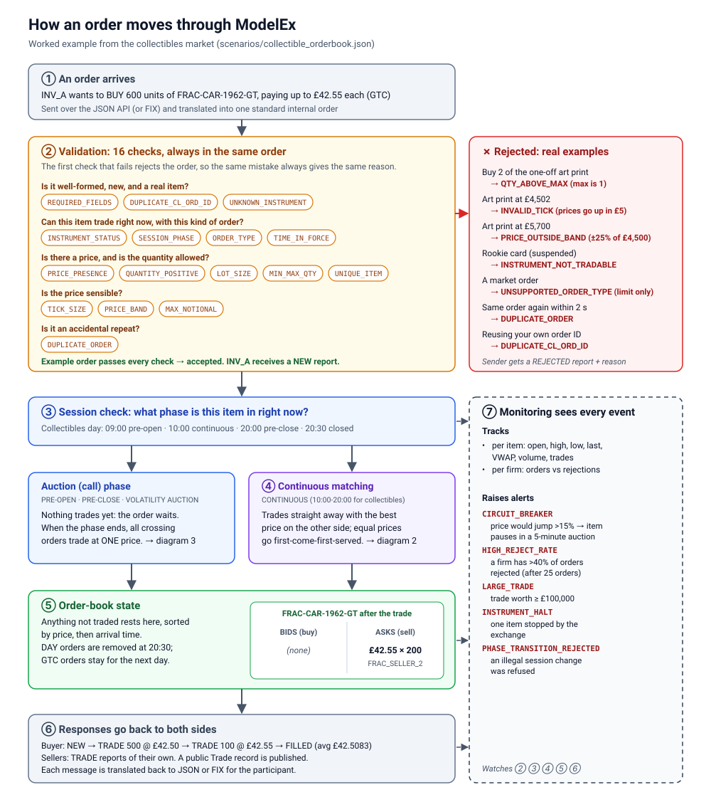
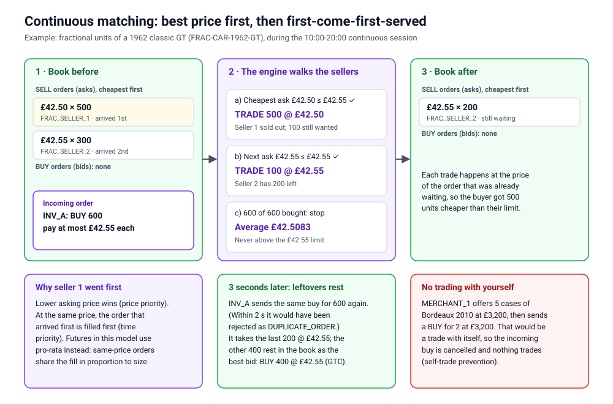
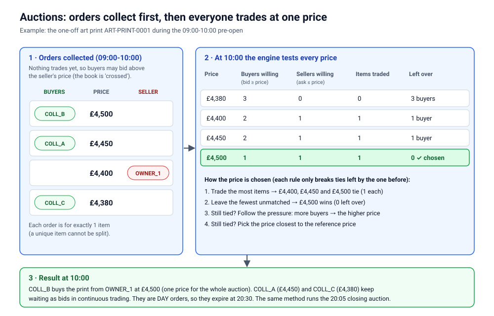
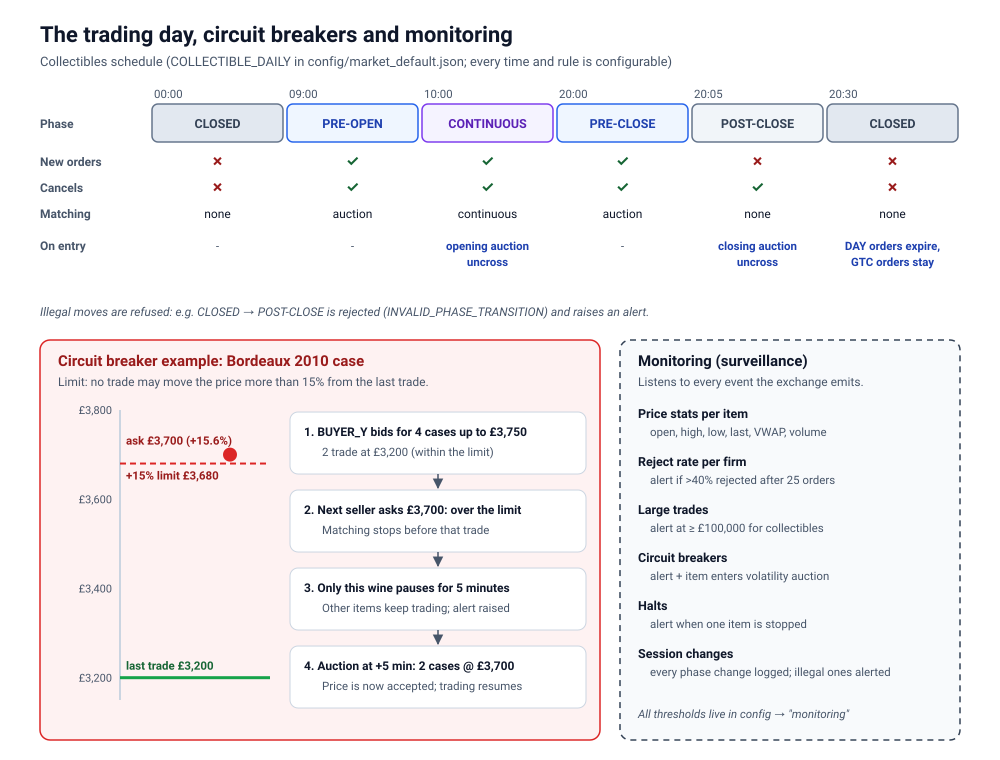

# How ModelEx works: a plain-English guide

This guide follows real trades through the exchange, using the **collectibles market**: a one-off art print, fractional shares in a classic car, and cases of fine wine. Every number in it comes from the bundled test order book, [`scenarios/collectible_orderbook.json`](../scenarios/collectible_orderbook.json). Run it yourself with:

```bash
python -m modelex scenario scenarios/collectible_orderbook.json -v
```

An exchange does five jobs:

1. **Check** each order (validation).
2. **Decide** what is allowed right now (the session).
3. **Pair up** buyers and sellers (matching).
4. **Remember** what hasn't traded yet (the order book).
5. **Watch** everything for problems (monitoring).

---

## 1. The journey of one order



**① An order arrives.** An investor, `INV_A`, wants to buy 600 units of the classic car (`FRAC-CAR-1962-GT`) at no more than £42.55 each. Orders can arrive in different "languages" (FIX, the standard in finance, or a JSON web API). ModelEx translates them all into one internal format, so the rest of the exchange doesn't care which one was used.

**② Validation.** Before anything else, the order passes through 16 checks in a fixed order. The first check that fails rejects the order and sends back the reason. Because the order is fixed, the same mistake always produces the same reason, which is what testers need. The checks answer five plain questions:

| Question | Checks | Collectibles example that fails |
|---|---|---|
| Is it well-formed, new, and a real item? | `REQUIRED_FIELDS`, `DUPLICATE_CL_ORD_ID`, `UNKNOWN_INSTRUMENT` | Reusing an order ID you already used today |
| Can this item trade right now, with this kind of order? | `INSTRUMENT_STATUS`, `SESSION_PHASE`, `ORDER_TYPE`, `TIME_IN_FORCE` | The rookie card is suspended for authentication; collectibles accept limit orders only, never market orders |
| Is there a price, and is the quantity allowed? | `PRICE_PRESENCE`, `QUANTITY_POSITIVE`, `LOT_SIZE`, `MIN_MAX_QTY`, `UNIQUE_ITEM` | Trying to buy 2 of a one-off art print |
| Is the price sensible? | `TICK_SIZE`, `PRICE_BAND`, `MAX_NOTIONAL` | £4,502 (prices above £1,000 move in £5 steps); £5,700 (more than 25% above the £4,500 reference); an order worth over £100,000 |
| Is it an accidental repeat? | `DUPLICATE_ORDER` | The identical order sent twice within 2 seconds, a "fat finger" |

Which checks run, and in what order, is set per market in [`config/market_default.json`](../config/market_default.json). The item details (tick sizes, limits, which items are unique) come from the reference data in [`refdata/collectibles.json`](../refdata/collectibles.json).

**③ Session check.** What happens next depends on the time of day (see section 4). During an *auction* phase the order simply waits. During *continuous* trading it tries to trade immediately.

**④ Matching.** Pairs the buyer with the best sellers (section 2).

**⑤ Order book.** Anything that didn't trade waits here (section 2).

**⑥ Responses.** Both sides get execution reports (`NEW`, `TRADE`, `CANCELED`, `EXPIRED` or `REJECTED`), translated back into FIX or JSON.

**⑦ Monitoring.** Watches every one of these events (section 4).

---

## 2. Continuous matching: best price first, then first-come-first-served



Two sellers are waiting: one wants £42.50 for 500 units, the other £42.55 for 300. `INV_A` arrives wanting 600 at up to £42.55. The engine works through the sellers from cheapest to dearest:

1. 500 units trade at **£42.50**. Seller 1 is sold out.
2. 100 units trade at **£42.55**. Seller 2 has 200 left.
3. The buyer has all 600, at an average of **£42.5083**.

Three rules decide this:

- **Price priority.** The cheapest seller (or highest buyer) goes first.
- **Time priority.** At the *same* price, whoever arrived first goes first.
- **The trade happens at the waiting order's price.** That's why the buyer paid £42.50, not £42.55, for the first 500.

Two further rules apply:

- **Leftovers wait in the order book.** When `INV_A` repeats the order 3 seconds later, it takes the last 200 and the other 400 rest as the best bid.
- **You can't trade with yourself.** When a wine merchant tries to buy cases they are already selling, the incoming order is cancelled instead (*self-trade prevention*).

Other markets can use a different rule at the same price. Commodity futures in this model use **pro-rata**: if three sellers wait at one price with 10, 30 and 60 contracts, a buyer of 50 gets 5, 15 and 30, in proportion to size.

---

## 3. Auctions: everyone trades at one price



Before the market opens (09:00–10:00), orders are collected but nothing trades. That is how a fair opening price is found for something rare. The art print has one seller at £4,400 and three bidders at £4,500, £4,450 and £4,380.

At 10:00 the engine tests every candidate price, using four rules in turn:

1. Trade as many items as possible.
2. Leave as few unmatched orders as possible.
3. Lean towards whichever side has more pressure.
4. Stay closest to the reference price.

£4,500 wins because exactly one buyer and one seller are willing at that price, with nobody left unmatched. `COLL_B` buys the print. The same method runs:

- the closing auction (20:00–20:05)
- the short "volatility auction" that follows a circuit breaker (below)

---

## 4. The trading day, circuit breakers and monitoring



**The session** is a timetable of *phases*. Each phase sets whether new orders and cancels are accepted and how matching works:

| Phase | New orders | Matching |
|---|---|---|
| Closed | ✗ | none |
| Pre-open (09:00) | ✓ | auction, uncrosses at 10:00 |
| Continuous (10:00) | ✓ | immediate |
| Pre-close (20:00) | ✓ | auction, uncrosses at 20:05 |
| Post-close (20:05) | ✗ (cancels only) | none |
| Closed (20:30) | ✗ | DAY orders expire; GTC ("good till cancelled") orders stay |

Phases can only move along allowed paths. An attempt to jump straight from *closed* to *post-close* is refused and logged.

**Circuit breakers** stop sudden price jumps. The last wine trade was at £3,200, and the limit is a 15% move, so any trade above £3,680 is blocked. A buyer takes 2 cases at £3,200, but the next seller is asking £3,700 (+15.6%). Matching stops there. *Only that wine* enters a 5-minute auction while everything else keeps trading. When the auction ends, 2 cases trade at £3,700 and normal trading resumes.

**Monitoring** (surveillance) listens to every event and tracks:

- prices per item (open, high, low, last, VWAP, volume)
- each firm's reject rate

It raises alerts for:

- circuit breakers
- halts
- unusually large trades (£100,000+ for collectibles)
- firms with too many rejections (over 40% after 25 orders)
- refused session changes

---

## 5. How this is used for testing

Because ModelEx is predictable and driven by configuration, it can act as the **reference model** for a real exchange:

- **Business analysts** write scenarios like the one above in JSON and check the expected outcome *before* the real system is built.
- **Testers** let the generator create thousands of realistic orders. After every step, ModelEx checks 20 rules that must always hold, for example "a buyer never pays more than their limit" and "the book is never crossed during continuous trading".
- **The same order stream** is replayed against the real exchange, and every response is compared. Any difference is either a bug in the real system or a gap in the specification.
- **Trainers** can step through auctions, circuit breakers and rejections one order at a time.

## Glossary

| Term | Meaning |
|---|---|
| **Participant** | The firm or account sending orders (e.g. `INV_A`). |
| **cl_ord_id** | The participant's own reference for each request. It must be unique per participant per day. A new one is used for every amend or cancel. |
| **Order ID** | The exchange's permanent reference for an order. |
| **Bid / ask** | An order to buy / an order to sell. |
| **Order book** | All waiting bids and asks for one item, best price first. |
| **Tick size** | The smallest allowed price step (e.g. £5 for items over £1,000). |
| **Lot size** | The smallest allowed quantity step. |
| **Price band** | How far from the reference price an order may be priced (±25% for collectibles). |
| **Limit order** | Trade at this price or better. |
| **Market order** | Trade at any price (not allowed for collectibles). |
| **DAY / GTC** | Order expires at the close / stays until cancelled. |
| **IOC / FOK** | Trade what you can now and cancel the rest / all-or-nothing, right now. |
| **Uncross** | The moment an auction's single price is set and its trades happen. |
| **Circuit breaker** | Pauses an item into an auction when its price would jump too far. |
| **Self-trade prevention** | Stops a firm trading with itself. |

*Diagrams are generated by [`docs/diagrams/build_diagrams.py`](diagrams/build_diagrams.py). Edit and re-run it to change them.*
